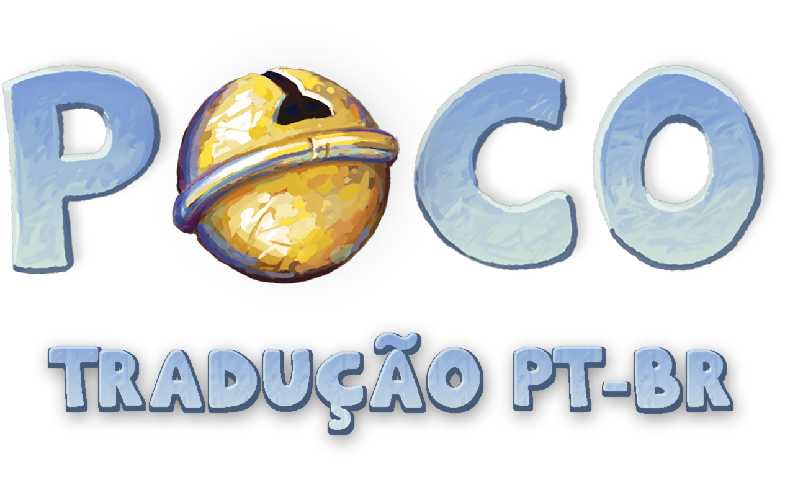

<p align="center">
  
</p>

# Poco - Tradução PT-BR

[-239120.svg)]()
[]()
[]()
[]()

Plugin de localização em **Português do Brasil (PT-BR)** desenvolvido em C# para o jogo **[Poco](https://store.steampowered.com/app/3454610/Poco/)** (Unity 2022.3 Mono).

---

## Sobre o Projeto

- Tradução completa de todos os diálogos, escolhas interativas, menus, créditos e dos 42 itens do inventário.
- Adaptação de trocadilhos, referências culturais e rimas do roteiro original.
- Suporte completo à acentuação em português (`á, é, í, ó, ú, â, ê, ô, ã, õ, ç, à`) integrado à fonte manuscrita original do jogo.
- Injeção em tempo de execução via BepInEx 5 e Harmony, mantendo os binários e assets originais intactos.

---

## Instalação

1. Baixe o arquivo **[Poco_Traducao_PTBR_v1.0.0.zip](../../releases/latest)** na aba **Releases**.
2. Abra a pasta local do jogo:
   - Na Biblioteca da Steam, clique com o botão direito em **Poco** > **Gerenciar** > **Navegar pelos arquivos locais**.
3. Extraia todo o conteúdo do `.zip` dentro da pasta do jogo (junto ao `Poco.exe`).
4. Inicie o jogo normalmente pela Steam.

### Desinstalação

Para remover o plugin e voltar ao idioma original, apague a pasta `BepInEx/`, o arquivo `winhttp.dll` e o `doorstop_config.ini` da pasta do jogo.

---

## Engenharia Reversa e Arquitetura (C# / Unity)

O jogo original não possui sistema nativo de múltiplos idiomas, com strings distribuídas entre tabelas CSV internas em `TextAssets`, componentes serializados de cenas (`TextMeshProUGUI` / `TMP_Text`) e lógica hardcoded em `Assembly-CSharp.dll`.

Principais soluções implementadas em [`src/PocoTranslation/Plugin.cs`](src/PocoTranslation/Plugin.cs):

- **Análise de Binários e Assets Unity:** Descompilação da `Assembly-CSharp.dll` e inspeção das árvores de tipos (`MonoBehaviour`, `TextAsset`, `TMP_FontAsset` e `Sprite`) nos arquivos `.assets` e `level*` para mapear o pipeline de diálogos, inventário, minigames e UI.
- **Runtime Method Patching (HarmonyX):** Hooks (`Prefix` e `Postfix`) sobre os controladores de diálogo (`DialogueManager`), sistema de inventário (`InventoryManager`), prompts de mundo (`ItemPromptPoint`), opções e créditos, interceptando e substituindo estruturas de dados na memória antes da renderização.
- **Reconstrução Tipográfica e Atlas SDF (`TextMeshPro`):** A fonte original do jogo (*upo2*) continha apenas glifos ASCII básicos. Foi compilada uma fonte TTF customizada (`Poco-PTBR.ttf`) preservando os traços caligráficos do autor para os diacríticos do português, injetada em runtime via `TMP_FontAsset.CreateFontAsset` com sincronização manual de métricas (`FaceInfo`, `scale`, `ascentLine` e `baseline`) na tabela de `fallbackFontAssetTable`.
- **Sanitização Seletiva de Fonte Simbólica:** Identificação em tempo de execução do uso da fonte simbólica *jinglejangle* (linguagem de ícones do protagonista) para preservar o mapeamento ASCII dos símbolos sem colisão com os caracteres acentuados.
- **Substituição Dinâmica de Texturas e UI (`IMGUI` / `ImageConversion`):** Injeção em memória de sprites traduzidos para botões gráficos e renderização de painel lateral de leitura para documentos manuscritos inspecionáveis em cena.

---

## Compilação

Requer o .NET SDK instalado e os binários gerenciados do jogo em `Poco_Data/Managed/`:

```bash
git clone https://github.com/gamesapeca/poco-traducao-ptbr.git
cd poco-traducao-ptbr
dotnet build src/PocoTranslation/PocoTranslation.csproj -c Release
```

---

## Créditos

- **Engenharia Reversa, Desenvolvimento C# e Tradução:** `gamesapeca`
- **Jogo Original:** Whalefall Games

---

## Licença

Distribuído sob a licença [MIT](LICENSE). *Poco* pertence aos seus respectivos criadores. Este projeto é uma tradução independente feita para a comunidade.
